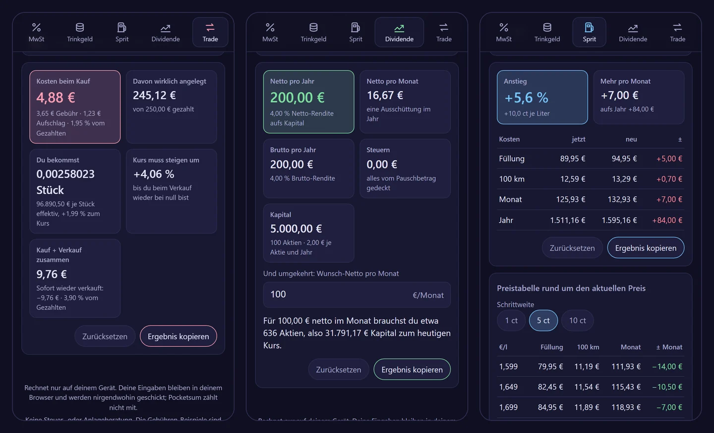

# Pocketsum

**Fünf kleine Rechner, die nichts von dir wollen.** Mehrwertsteuer, Trinkgeld, Spritpreis, Dividende und Trade-Kosten – in einer einzigen Datei, die im Browser läuft, nach dem ersten Besuch auch ohne Netz funktioniert und deine Eingaben nirgendwohin schickt.

  

**Live:** https://dennismit2n.github.io/pocketsum/ · [English version](README.md)



## Die fünf Rechner

| | |
|---|---|
| **Mehrwertsteuer** | Netto zu brutto und brutto zu netto, mit 19 %, 7 %, 0 % oder eigenem Satz. Zeigt den Rechenweg. |
| **Trinkgeld** | Prozent oder eigener Satz, rundet den Gesamtbetrag auf 50 Cent, volle Euro oder 5 Euro auf, teilt auf mehrere Personen auf – und sagt dir, was du sagen kannst: „Mach 50,00 €.“ |
| **Spritpreis** | Was ein Preisanstieg pro Tankfüllung, pro 100 km, pro Monat und pro Jahr kostet, nach deinem Tank, Verbrauch und deiner Fahrleistung. Dazu eine Preistabelle rund um den aktuellen Preis in 1-, 5- oder 10-Cent-Schritten. |
| **Dividende** | Brutto, Steuer und Netto pro Jahr, pro Ausschüttung und pro Monat, aus Stückzahl oder Anlagebetrag. Deutsches Steuerrecht: 25 % Abgeltungsteuer, Soli, Kirchensteuer (§ 32d EStG), Sparer-Pauschbetrag, Anrechnung ausländischer Quellensteuer bis 15 % und die Teilfreistellung für Aktien- und Mischfonds (§ 20 InvStG). Und umgekehrt: wie viele Aktien für ein Wunsch-Netto pro Monat. |
| **Trade-Kosten** | Was ein Kauf von Aktien, ETF oder Krypto wirklich kostet: Gebühr in Prozent, fest, mindestens und Aufschlag, Gebühren im Betrag enthalten oder obendrauf. Zeigt, was wirklich angelegt ist, wie viele Stück du bekommst, den effektiven Kurs je Stück, um wie viel der Kurs steigen muss, bis du beim Verkauf wieder bei null bist, und die Kosten für Kauf plus Verkauf. Beispiel-Gebührenmodelle zum Start – keine Preislisten echter Anbieter. |

## Klug mit Zahlen

„5.000“ heißt auf Deutsch fünftausend und auf Englisch fünf. Pocketsum liest Zahlen in der Schreibweise der gewählten Sprache: Komma oder Punkt als Dezimalzeichen, Punkte, Kommas oder Leerzeichen als Tausendertrenner, „250,-“ und ein typografisches Minus. Nur Spritpreise mit drei Nachkommastellen (1,899 €/l) lesen das Trennzeichen immer als Dezimalzeichen. Wechselst du die Sprache, rechnet Pocketsum die Feldinhalte mit um, damit nichts seine Bedeutung ändert. Was sich nicht lesen lässt, bekommt einen roten Rahmen, statt still als null zu gelten.

## Privatsphäre

- Gerechnet wird auf deinem Gerät. Deine Eingaben bleiben im lokalen Speicher deines Browsers, damit die Felder beim nächsten Mal noch ausgefüllt sind – sonst nichts.
- Kein Konto, keine Werbung, keine Cookies, keine Besuchszählung.
- Die Seite trägt eine Content Security Policy mit `connect-src 'none'`: Der Browser selbst blockiert jede Abfrage per fetch, XHR, WebSocket oder Beacon, die die Seite versuchen könnte, und von fremden Seiten wird nichts geladen. Das lässt sich in den Entwicklerwerkzeugen nachprüfen.

## Offline und als eine Datei

Nach dem ersten Besuch hält ein Service Worker die App ohne Netz bereit; in Chrome, Edge und Samsung Internet erscheint oben der Knopf „Installieren“, der sie als App einrichtet – auf dem Handy wie am PC. Oder du lädst die Seite selbst herunter – „Als eine Datei herunterladen“ unten in der Fußzeile speichert `pocketsum.html`: Sie enthält alles (Gestaltung, Rechnungen, alle 14 Sprachen) und läuft per Doppelklick von deiner Festplatte.

## Sprachen

Deutsch, Englisch, Spanisch, Französisch, Italienisch, Niederländisch, Polnisch, Portugiesisch, Türkisch, Russisch, Hindi, Chinesisch, Japanisch und Koreanisch. Die App folgt der Sprache deines Browsers und merkt sich deine Wahl. Teils maschinell übersetzt – Korrekturen sind sehr willkommen.

## Keine Beratung

Pocketsum ist ein Rechner, keine Steuer- oder Anlageberatung. Der Dividendenrechner folgt dem deutschen Steuerrecht in vereinfachter Form, und die Gebühren-Beispiele sind Platzhalter: Trag die Preisliste deines Anbieters ein.

## Entwicklung

Kein Build-Schritt, keine Abhängigkeiten. Alles steht in `index.html`: die Gestaltung, der Rechenkern (`<script id="kg-mathe">`, reine Funktionen ohne DOM), die Übersetzungen (`<script id="kg-i18n">`) und die Oberfläche.

```
node --test "tests/*.test.mjs"
```

Die Tests prüfen den Rechenkern (Mehrwertsteuer, Trinkgeld-Rundung, Spritpreis-Tabellen, deutsche Dividendenbesteuerung, Trade-Kosten und Break-even, den Zahlenleser in beiden Schreibweisen) und die Übersetzungen (gleiche Schlüssel und Platzhalter in allen 14 Sprachen, keine unbenutzten oder fehlenden Schlüssel). In `tools/` liegen die Skripte für Bildschirmfotos, Symbole und das Vorschaubild; sie nutzen Playwright aus einem Nachbar-Repository und werden zum Betrieb der App nicht gebraucht.

## Lizenz

[MIT](LICENSE)

© 2026 Dennis_mit_2n · Teil der [Werkstatt](https://dennismit2n.github.io/)
