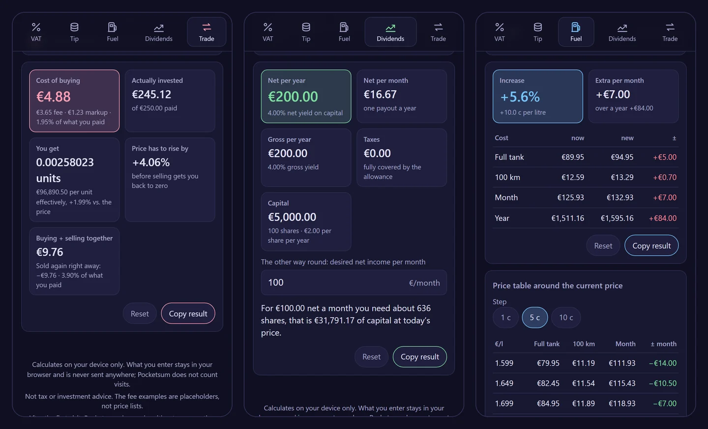

# Pocketsum

**Five small calculators that want nothing from you.** VAT, tips, fuel prices, dividends and trading costs – in one single file that runs in your browser, works offline after the first visit and never sends what you enter anywhere.

  

**Live:** https://dennismit2n.github.io/pocketsum/ · [Deutsche Fassung](README.de.md)



## The five calculators

| | |
|---|---|
| **VAT** | Net to gross and gross to net, with 19%, 7%, 0% or your own rate. Shows how it is calculated. |
| **Tip** | Percentage or your own rate, rounds the total up to 50 cents, whole euros or 5 euros, splits the bill between several people – and tells you what to say: “Make it €50.00.” |
| **Fuel** | What a price rise costs per full tank, per 100 km, per month and per year, based on your tank, consumption and mileage. Plus a price table around the current price in 1, 5 or 10 cent steps. |
| **Dividends** | Gross, tax and net per year, per payout and per month, from a number of shares or an amount invested. German tax law: 25% flat tax, solidarity surcharge, church tax (§ 32d EStG), saver’s allowance, credit for foreign withholding tax up to 15%, and the partial exemption for equity and mixed funds (§ 20 InvStG). And the other way round: how many shares for a desired net income per month. |
| **Trading costs** | What buying shares, ETFs or crypto really costs: percentage fee, fixed fee, minimum fee and markup, fees included in the amount or on top. Shows what is actually invested, how many units you get, the effective price per unit, how far the price has to rise before selling gets you back to zero, and the cost of buying plus selling. Sample fee models to start from – not price lists of real providers. |

## Smart about numbers

“5.000” means five thousand in German and five in English. Pocketsum reads numbers in the convention of the language you picked: comma or point as decimal mark, points, commas or spaces as thousands separators, “250,-” and a typographic minus. Only fuel prices with three decimals (1.899 €/l) always read the separator as a decimal mark. Switching the language converts what is already in the fields, so nothing changes its meaning. Input it cannot read is outlined in red instead of silently becoming zero.

## Privacy

- Everything is calculated on your device. What you enter stays in your browser’s local storage, so the fields are filled the next time you come back – nothing else.
- No account, no ads, no cookies, no visit counting.
- The page carries a Content Security Policy with `connect-src 'none'`: the browser itself blocks any fetch, XHR, WebSocket or beacon the page might attempt, and nothing is loaded from other sites. You can check it in the developer tools.

## Offline and as a single file

After the first visit, a service worker keeps the app available without a connection; it can be added to the home screen on Android. Or download the page itself – “Download as a single file” in the footer saves `pocketsum.html`: it contains everything (styles, the calculations, all 14 languages) and runs from your drive with a double click.

## Languages

German, English, Spanish, French, Italian, Dutch, Polish, Portuguese, Turkish, Russian, Hindi, Chinese, Japanese and Korean. The app follows your browser’s language and remembers your choice. Some translations are machine-made – corrections are very welcome.

## Not advice

Pocketsum is a calculator, not tax or investment advice. The dividend calculator follows German tax law in a simplified form, and the fee examples are placeholders: enter the price list of your own provider.

## Development

No build step and no dependencies. Everything lives in `index.html`: the styles, the calculation core (`<script id="kg-mathe">`, pure functions without DOM), the translations (`<script id="kg-i18n">`) and the interface.

```
node --test "tests/*.test.mjs"
```

The tests check the calculation core (VAT, tip rounding, fuel tables, German dividend taxation, trading costs and break-even, the number parser in both conventions) and the translations (same keys and placeholders in all 14 languages, no unused or missing keys). `tools/` holds the scripts for screenshots, icons and the preview image; they use Playwright from a neighbouring repository and are not needed to run the app.

## Licence

[MIT](LICENSE)

© 2026 Dennis_mit_2n · part of [the workshop](https://dennismit2n.github.io/)
